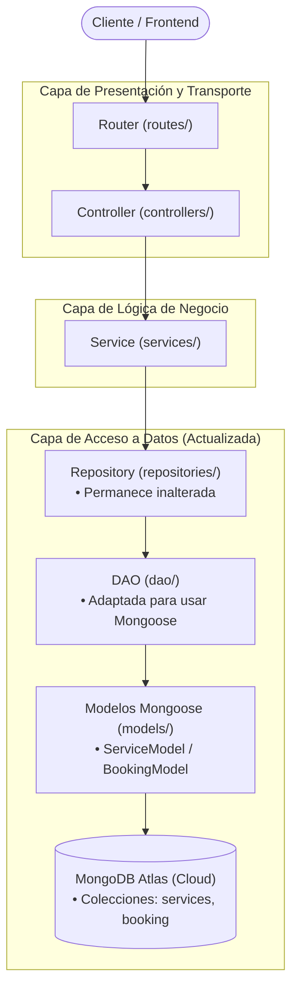

# 6-turnos-BE - Sistema de Gestión de Turnos (Integración con MongoDB y Mongoose)

Sexta iteración del backend para la gestión de turnos y servicios. En este proyecto se sustituye la persistencia en archivos JSON por una base de datos documental **MongoDB (NoSQL)** utilizando el ODM **Mongoose**, demostrando el poder de la arquitectura en capas para desacoplar el almacenamiento de la lógica del negocio.

---

## 📋 Descripción y Nuevas Actualizaciones

En comparación con `5-turnos-BE`, esta versión introduce los siguientes cambios fundamentales:

1. **Migración a Base de Datos MongoDB con Mongoose**:
   - Se reemplaza la lectura y escritura sobre archivos JSON por operaciones sobre colecciones en MongoDB.
   - Se añade la dependencia oficial `mongoose`.
2. **Modelos de Datos con Esquemas Fuertes (`src/models/`)**:
   - `src/models/services.model.js`: Define `ServiceSchema` y compila el modelo `ServiceModel` para la colección `services`.
   - `src/models/bookings.model.js`: Define `BookingSchema` y el subdocumento `ServiceByBookingSchema`, compilando `BookingModel` para la colección `booking`.
3. **El Triunfo de la Arquitectura en Capas**:
   - La migración de base de datos **únicamente requirió reescribir la capa DAO** (`src/dao/services.dao.js` y `src/dao/bookings.dao.js`).
   - Los controladores, routers, servicios de negocio y repositorios no necesitaron cambios estructurales.
4. **Gestión de Conexión a Base de Datos (`src/config/database.config.js`)**:
   - Módulo asíncrono `connectDB()` para inicializar la conexión con el clúster antes de recibir peticiones.
   - Configuración DNS preventiva en `src/server.js` (`dns.setServers(['8.8.8.8', '8.8.4.4'])`) para asegurar la resolución de nombres SRV en redes locales.
5. **Nuevos Identificadores de Entidad**:
   - Las entidades ahora utilizan identificadores estándar de MongoDB (`_id` ObjectId de 24 caracteres hexadecimales).

---

## 🏛️ La Arquitectura en Capas en Acción



---

## 🛠️ Requisitos Previos

- **Node.js** (versión 18 o superior)
- **npm**
- Una instancia de **MongoDB** activa (local o clúster en MongoDB Atlas)

---

## ⚙️ Variables de Entorno

El proyecto requiere tres variables de entorno indispensables en `.env` (guíate con `.env.example`):

```env
PORT=8080
NODE_ENV=development
MONGO_DB_URI=mongodb+srv://<usuario>:<password>@<cluster>.mongodb.net/<nombre-bd>
```

| Variable | Tipo | Obligatoria | Descripción |
| :--- | :--- | :--- | :--- |
| `PORT` | Number | Sí | Puerto donde escucha el servidor |
| `NODE_ENV` | String | Sí | Modo de entorno (`development` / `production`) |
| `MONGO_DB_URI` | String | Sí | Cadena de conexión URI a MongoDB |

---

## 📦 Cómo Instalar

1. Navega al directorio del proyecto:
   ```bash
   cd 6-turnos-BE
   ```

2. Instala las dependencias:
   ```bash
   npm install
   ```

3. Crea y edita tu archivo `.env`:
   ```bash
   cp .env.example .env
   ```
   *(En PowerShell: `Copy-Item .env.example .env`)*

---

## 🚀 Cómo Ejecutar

- **Modo Desarrollo** (con reinicio automático al guardar cambios):
  ```bash
  npm run dev
  ```

- **Modo Producción**:
  ```bash
  npm start
  ```

Al iniciar correctamente verás en la consola:
```text
Conexion con la base de datos exitosa
Servidor HTTP en http://localhost:8080 (development)
```

---

## 📁 Estructura del Proyecto

```text
6-turnos-BE/
├── .env.example
├── package.json
├── src/
│   ├── app.js                          # Configuración de Express
│   ├── server.js                       # Inicio del servidor y conexión DB
│   ├── config/
│   │   ├── database.config.js          # [NUEVO] Conexión Mongoose a MongoDB
│   │   └── env.config.js               # Validación de variables (incluye MONGO_DB_URI)
│   ├── controllers/                    # Controladores HTTP
│   │   ├── bookings.controller.js
│   │   └── services.controller.js
│   ├── services/                       # Lógica de negocio
│   │   ├── bookings.service.js
│   │   └── services.service.js
│   ├── repositories/                   # Abstracción de acceso a datos
│   │   ├── bookings.repository.js
│   │   └── services.repository.js
│   ├── dao/                            # [ACTUALIZADO] DAOs con consultas Mongoose
│   │   ├── bookings.dao.js
│   │   └── services.dao.js
│   ├── models/                         # [NUEVO] Modelos y Schemas Mongoose
│   │   ├── bookings.model.js
│   │   └── services.model.js
│   ├── routes/                         # Enrutadores
│   │   ├── booking.router.js
│   │   └── services.router.js
│   └── utils/
│       └── http.js
```

---

## 🏷️ Descripción de Recursos y Modelos

### 1. Recurso `services` (Colección `services`)

| Campo | Tipo Mongoose | Requerido | Descripción |
| :--- | :--- | :--- | :--- |
| `_id` | ObjectId | Autogenerado | Identificador único de MongoDB |
| `name` | String | Sí | Nombre del servicio |
| `description` | String | Sí | Descripción |
| `duration` | Number | Sí | Duración en minutos |
| `price` | Number | Sí | Precio monetario |
| `category` | String | Sí | Categoría clasificatoria |
| `available` | Boolean | Sí | Si está activo |

---

### 2. Recurso `bookings` (Colección `booking`)

| Campo | Tipo Mongoose | Requerido | Descripción |
| :--- | :--- | :--- | :--- |
| `_id` | ObjectId | Autogenerado | Identificador único del turno |
| `clientName` | String | Sí | Nombre completo del cliente |
| `clientEmail` | String | Sí | Correo electrónico de contacto |
| `date` | String | Sí | Fecha de la cita (`YYYY-MM-DD`) |
| `time` | String | Sí | Hora de la cita (`HH:mm`) |
| `status` | String | Sí | Estado del turno (`confirmed`, `pending`, etc.) |
| `services` | `[ServiceByBookingSchema]` | Sí | Subdocumentos `{ service: String, quantity: Number }` |

---

## 🔌 Endpoints y Ejemplos de Uso

Los IDs (`:sid`, `:bid`) corresponden a ObjectIds de MongoDB (24 caracteres hex).

### Servicios (`/services`)

#### 1. Obtener todos los servicios
```bash
curl -X GET http://localhost:8080/services
```

**Respuesta Exitosa (200 OK):**
```json
{
  "status": "success",
  "payload": [
    {
      "_id": "664f1a23e59b1a03f491c011",
      "name": "Corte y Barba Completo",
      "description": "Corte de diseño y afeitado tradicional",
      "duration": 60,
      "price": 14000,
      "category": "Barbería",
      "available": true,
      "__v": 0
    }
  ]
}
```

---

#### 2. Obtener servicio por ID (`:sid`)
```bash
curl -X GET http://localhost:8080/services/664f1a23e59b1a03f491c011
```

---

#### 3. Crear nuevo servicio
```bash
curl -X POST http://localhost:8080/services \
  -H "Content-Type: application/json" \
  -d '{
    "name": "Drenaje Linfático",
    "description": "Sesión terapéutica corporal",
    "duration": 50,
    "price": 19000,
    "category": "Estética",
    "available": true
  }'
```

**Respuesta Exitosa (201 Created):**
```json
{
  "status": "success",
  "payload": {
    "_id": "664f208ce59b1a03f491c019",
    "name": "Drenaje Linfático",
    "description": "Sesión terapéutica corporal",
    "duration": 50,
    "price": 19000,
    "category": "Estética",
    "available": true,
    "__v": 0
  }
}
```

---

#### 4. Actualizar servicio (`:sid`)
```bash
curl -X PUT http://localhost:8080/services/664f208ce59b1a03f491c019 \
  -H "Content-Type: application/json" \
  -d '{
    "price": 21000
  }'
```

---

#### 5. Eliminar servicio (`:sid`)
```bash
curl -X DELETE http://localhost:8080/services/664f208ce59b1a03f491c019
```

---

### Reservas (`/bookings`)

#### 1. Obtener reserva por ID (`:bid`)
```bash
curl -X GET http://localhost:8080/bookings/664f22abe59b1a03f491c025
```

---

#### 2. Crear una reserva
```bash
curl -X POST http://localhost:8080/bookings \
  -H "Content-Type: application/json" \
  -d '{
    "clientName": "Martín Rodríguez",
    "clientEmail": "martin.rodriguez@example.com",
    "date": "2026-12-05",
    "time": "17:30",
    "status": "confirmed",
    "services": [
      {
        "service": "664f1a23e59b1a03f491c011",
        "quantity": 1
      }
    ]
  }'
```

---

#### 3. Agregar o incrementar un servicio en una reserva
```bash
curl -X POST http://localhost:8080/bookings/664f22abe59b1a03f491c025/services/664f208ce59b1a03f491c019
```

**Respuesta Exitosa (200 OK):**
```json
{
  "status": "success",
  "payload": {
    "_id": "664f22abe59b1a03f491c025",
    "clientName": "Martín Rodríguez",
    "clientEmail": "martin.rodriguez@example.com",
    "date": "2026-12-05",
    "time": "17:30",
    "status": "confirmed",
    "services": [
      {
        "service": "664f1a23e59b1a03f491c011",
        "quantity": 1,
        "_id": "664f22abe59b1a03f491c026"
      },
      {
        "service": "664f208ce59b1a03f491c019",
        "quantity": 1,
        "_id": "664f248de59b1a03f491c031"
      }
    ],
    "__v": 0
  }
}
```

